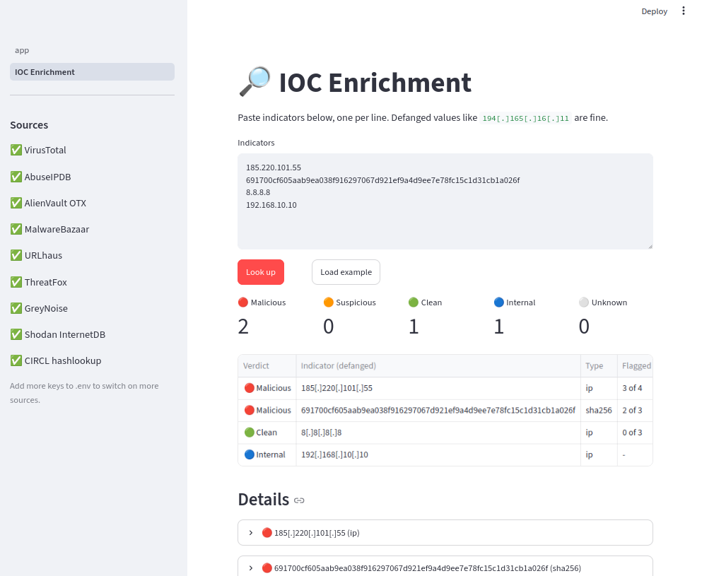
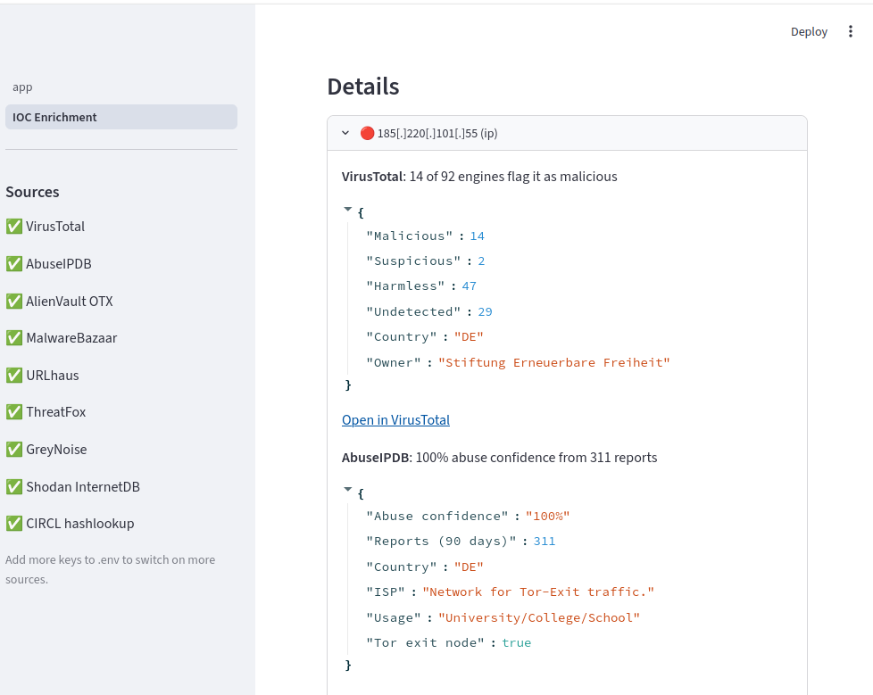
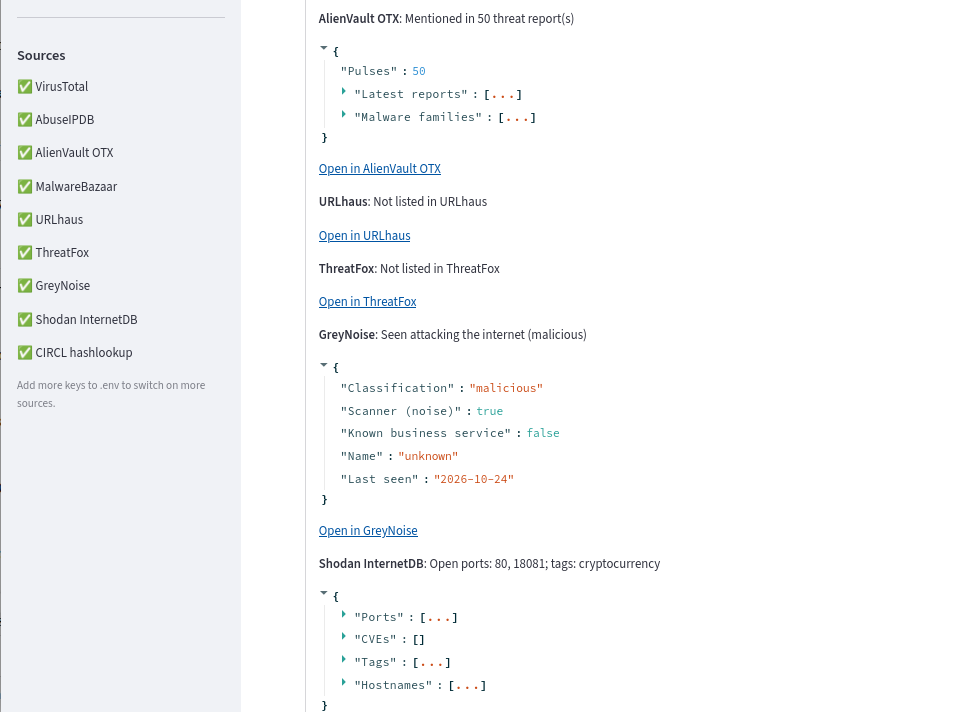
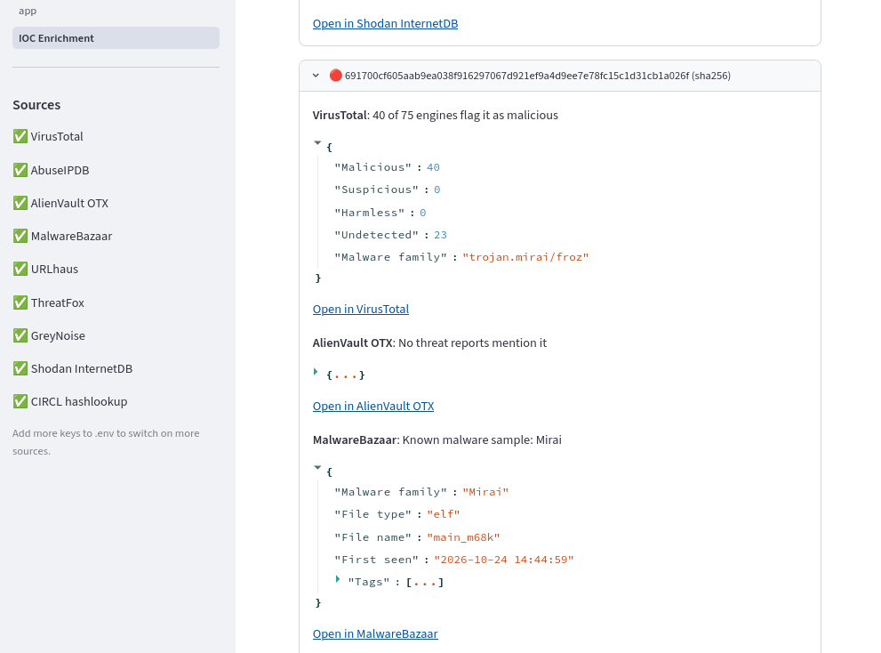
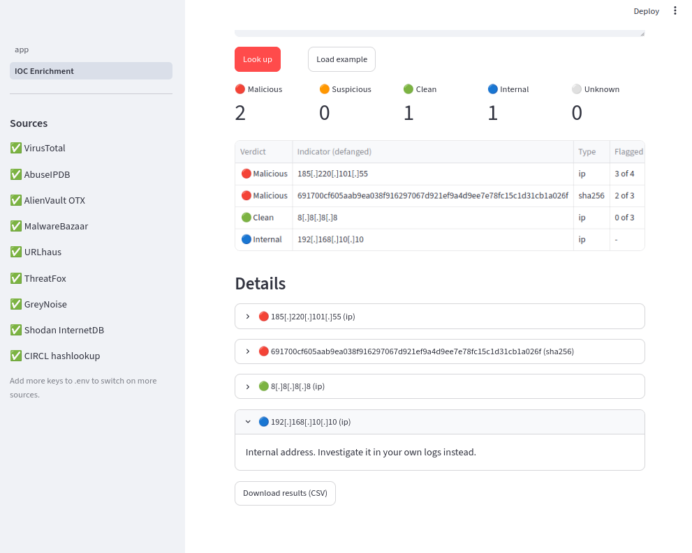
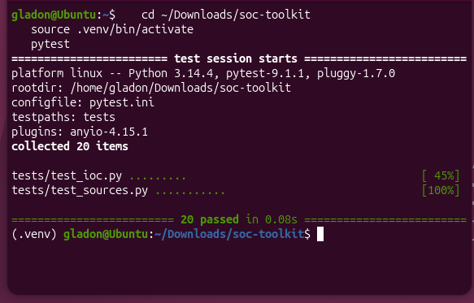
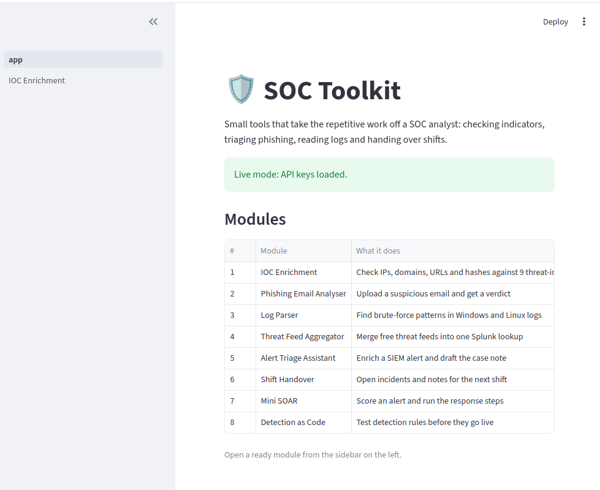
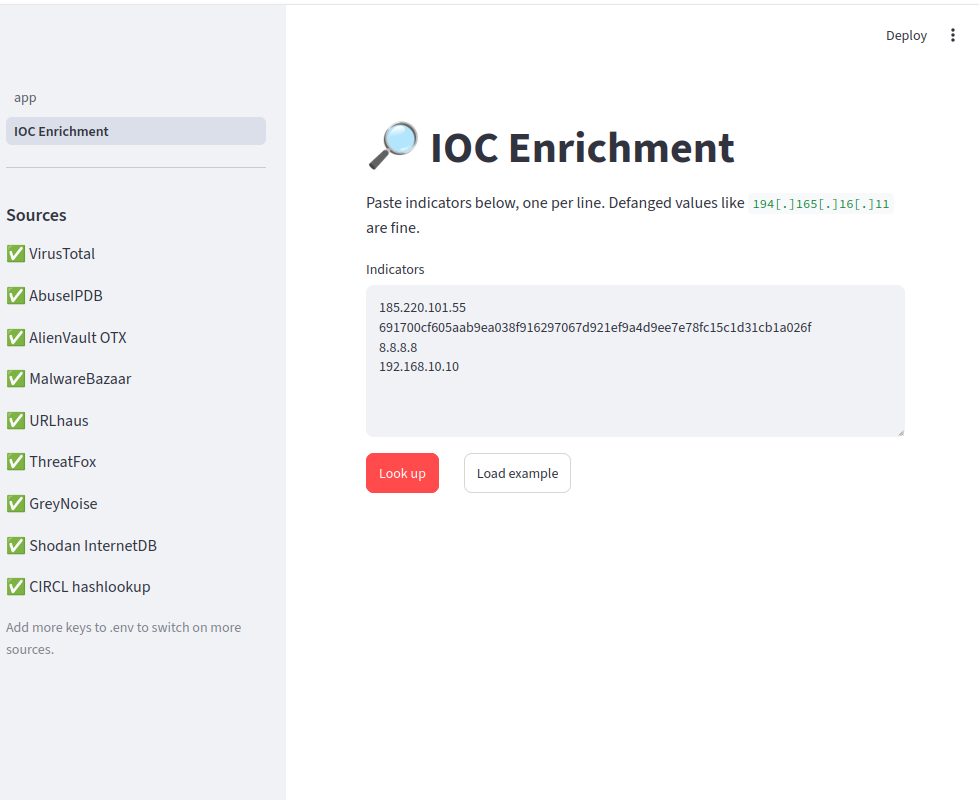

# SOC Toolkit

A set of small tools that take repetitive work off a SOC analyst, built as one Streamlit web app that runs on your own machine.

> Work in progress. Modules are added one at a time, and each one is tested before the next is started.



## Modules

| # | Module | What it does | Status |
|---|---|---|---|
| 1 | IOC Enrichment | Check IPs, domains, URLs and file hashes against 9 threat-intel sources in one go | ✅ Ready |
| 2 | Phishing Email Analyser | Upload a suspicious email and get a verdict | 🔜 Next |
| 3 | Log Parser | Find brute-force patterns in Windows and Linux logs | Planned |
| 4 | Threat Feed Aggregator | Merge free threat feeds into one Splunk lookup | Planned |
| 5 | Alert Triage Assistant | Enrich a SIEM alert and draft the case note | Planned |
| 6 | Shift Handover | Open incidents and notes for the next shift | Planned |
| 7 | Mini SOAR | Score an alert and run the response steps | Planned |
| 8 | Detection as Code | Test detection rules before they go live | Planned |

## Module 1: IOC Enrichment

Checking an indicator usually means opening VirusTotal, then AbuseIPDB, then OTX, then copying results into a ticket, one IOC at a time. This module asks up to 9 sources at once and gives one answer.

- Paste a list of indicators, including defanged ones like `194[.]165[.]16[.]11` or `hxxps://bad[.]site`
- It works out the type of each one (IP, domain, URL, MD5, SHA1, SHA256) and only asks the sources that can check that type
- Internal addresses (10.x, 172.16-31.x, 192.168.x) are flagged and never sent to outside services
- Each indicator gets one verdict (Malicious, Suspicious, Clean, Internal or Unknown) and a "flagged by" count such as **3 of 5**
- Results show defanged, so they're safe to paste into tickets, and can be downloaded as CSV
- Results are cached for an hour, and big batches are paced to stay inside the free VirusTotal limit

### Sources

| Source | Checks | Key | What it adds |
|---|---|---|---|
| VirusTotal | IP, domain, URL, hash | Free | Verdicts from ~90 security engines |
| AbuseIPDB | IP | Free | Community abuse reports |
| AlienVault OTX | IP, domain, URL, hash | Free | Threat reports ("pulses") and malware families |
| MalwareBazaar | Hash | Free (abuse.ch) | Known malware samples |
| URLhaus | URL, domain, IP | Free (abuse.ch) | Malware distribution sites |
| ThreatFox | IP, domain, URL, MD5, SHA256 | Free (abuse.ch) | C2 servers and attacker infrastructure |
| GreyNoise | IP | Optional | Mass internet scanners and known business services, to cut false positives |
| Shodan InternetDB | IP | None | Open ports, known CVEs and tags |
| CIRCL hashlookup | Hash | None | Known-good files, to cut false positives |

**Verdict logic:** each source gives a 0-100 score, or no opinion. The highest score wins: 50 or more is Malicious, 15 or more is Suspicious, anything lower is Clean. Two sources (GreyNoise and CIRCL) mainly say when something is *harmless*, which helps an analyst avoid escalating noise.

### Screenshots

**Every source agrees on a Tor exit node.** AbuseIPDB has 311 reports at 100% confidence, VirusTotal flags it with 14 engines, OTX links it to 50 threat reports and GreyNoise has seen it attacking the internet today.

| | |
|---|---|
|  |  |

**A malware hash identified by two sources.** VirusTotal and MalwareBazaar both name it as Mirai, Linux botnet malware.



**Internal addresses never leave the network.** 192.168.10.10 is flagged as internal and not sent to any outside service.



<details>
<summary>More screenshots: tests, home page and input</summary>





</details>

## Getting started

You need Python 3.10 or newer.

**Linux / macOS**

```bash
git clone https://github.com/GladonGetHub/soc-toolkit.git
cd soc-toolkit
python3 -m venv .venv
source .venv/bin/activate
pip install -r requirements.txt
streamlit run app.py
```

**Windows**

```bash
git clone https://github.com/GladonGetHub/soc-toolkit.git
cd soc-toolkit
python -m venv .venv
.venv\Scripts\activate
pip install -r requirements.txt
streamlit run app.py
```

Built and tested on Ubuntu with Python 3.14.

The app opens in your browser at http://localhost:8501.

**API keys (optional):** without keys the app runs in demo mode with sample data. For live lookups, copy `.env.example` to `.env` and add your free keys from [VirusTotal](https://www.virustotal.com), [AbuseIPDB](https://www.abuseipdb.com), [AlienVault OTX](https://otx.alienvault.com) and [abuse.ch](https://auth.abuse.ch). Any combination works; the app uses whichever keys are set. The `.env` file is ignored by git, so keys never reach GitHub.

**Tests:**

```bash
pytest
```

## Project structure

```
soc-toolkit/
├── app.py                   home page
├── pages/
│   └── 1_IOC_Enrichment.py  module 1 screen
├── soc_toolkit/
│   ├── ioc.py               detect, refang and defang indicators
│   ├── sources.py           one class per threat-intel source
│   ├── enrich.py            combines source scores into a verdict
│   └── config.py            loads API keys from .env
├── tests/                   20 unit tests (no API keys needed)
├── docs/                    how it works, and screenshots
├── .env.example             template for your API keys
└── requirements.txt
```

## Author

Gladon, SOC Analyst · MSc Cyber Security · [LinkedIn](https://www.linkedin.com/in/YOUR-PROFILE)
