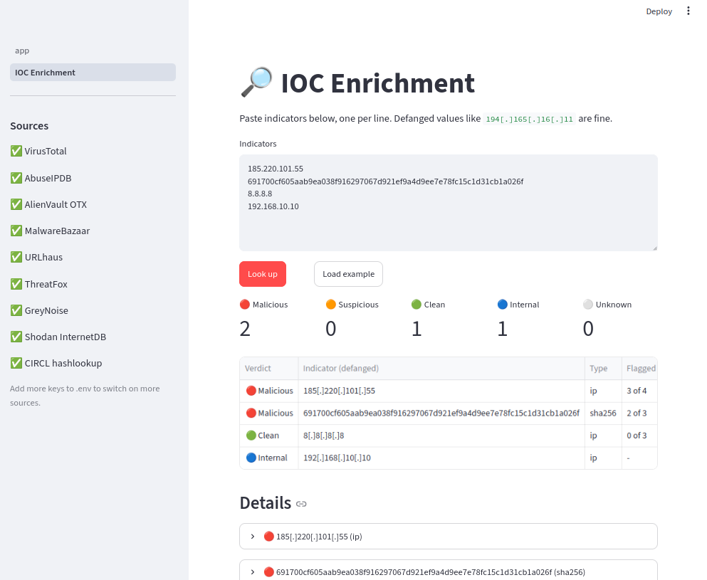
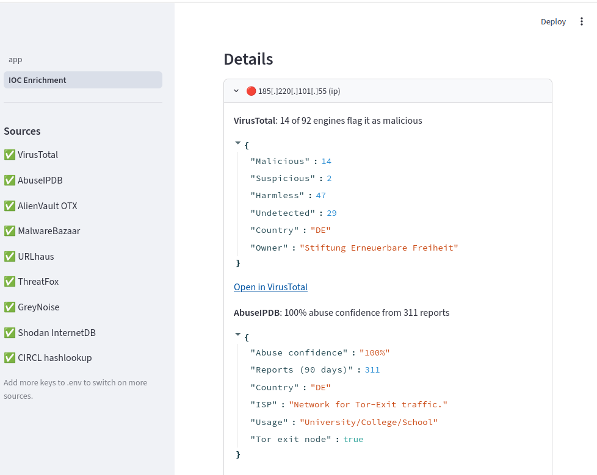
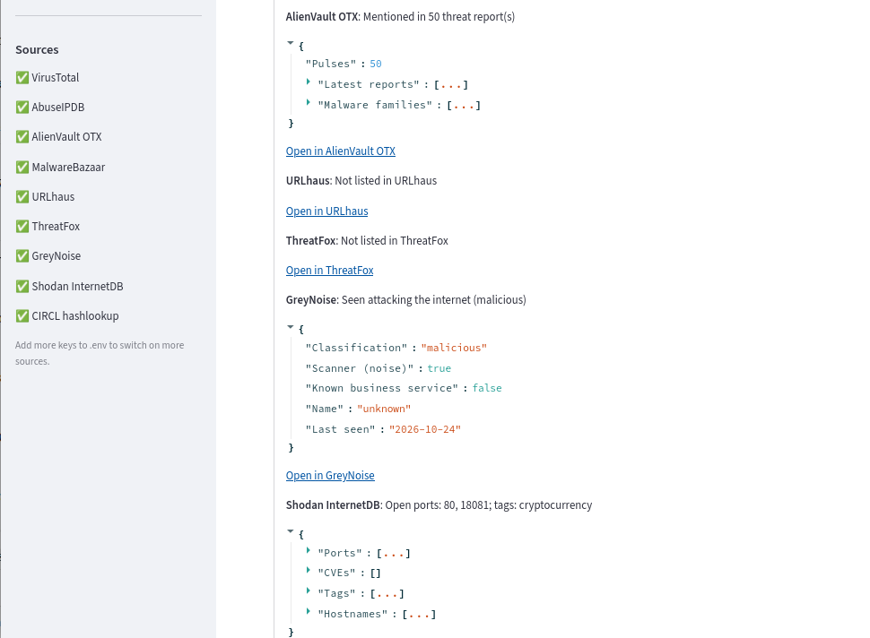
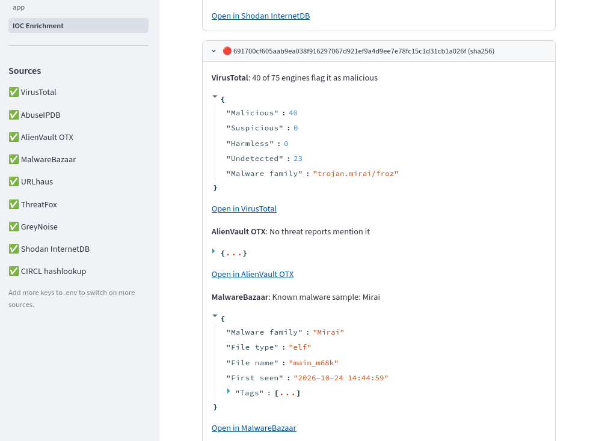
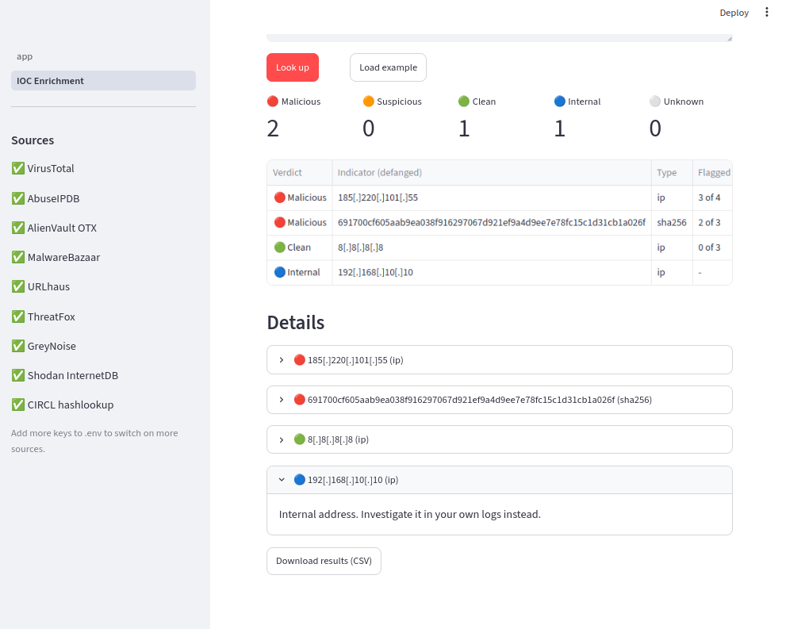
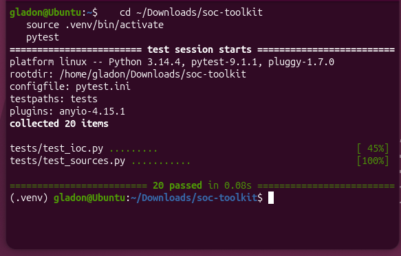
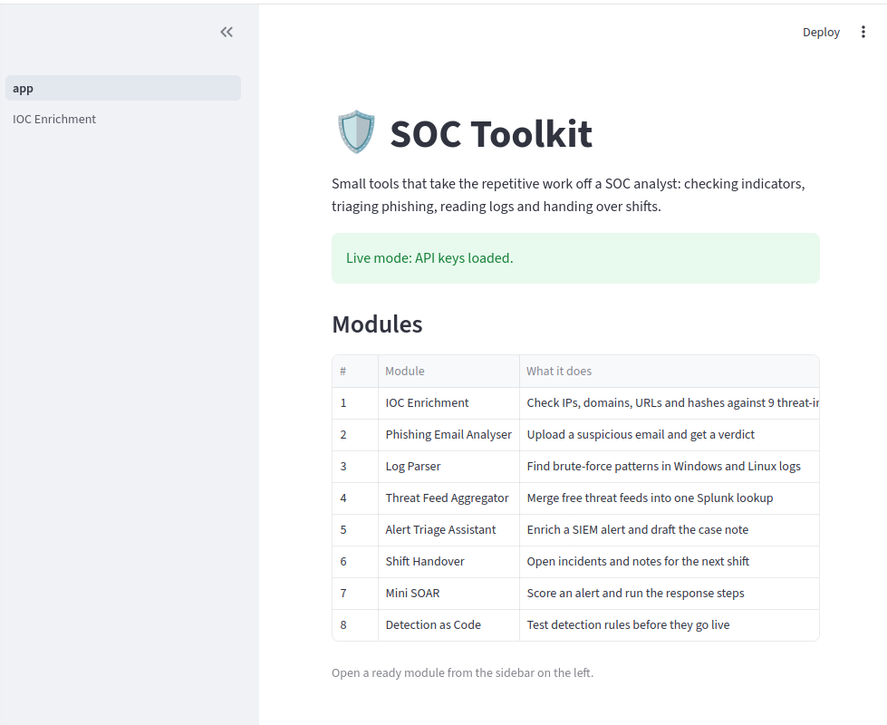
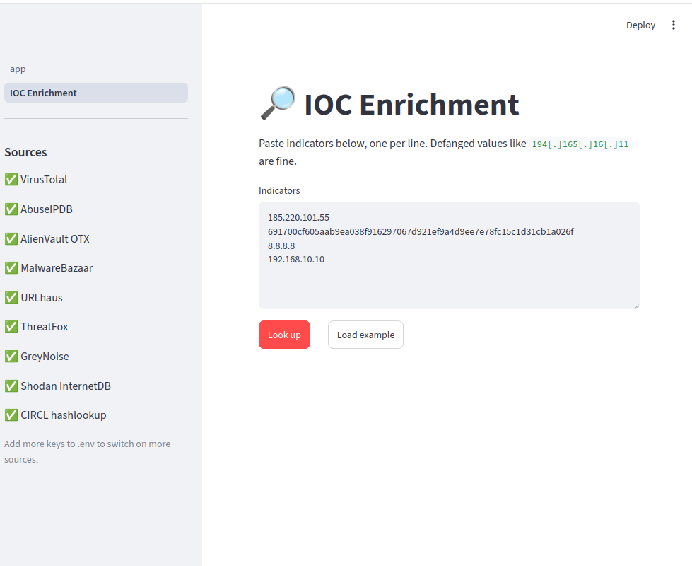

# SOC Toolkit

A set of small tools that take repetitive work off a SOC analyst, built as one Streamlit web app that runs on your own machine.

> Work in progress. Modules are added one at a time, and each one is tested before the next is started.

**Try it online:** [gladon-soc-toolkit.streamlit.app](https://gladon-soc-toolkit.streamlit.app). No sign-up or install needed.



## Modules

| # | Module | What it does | Status |
|---|---|---|---|
| 1 | IOC Enrichment | Check IPs, domains, URLs and file hashes against 9 threat-intel sources in one go | ✅ Ready |
| 2 | Phishing Email Analyser | Check an email's sender, links and attachments for phishing | 🔨 In progress (all checks done, case note next) |
| 3 | Log Parser | Find brute-force patterns in Windows and Linux logs | Planned |
| 4 | Threat Feed Aggregator | Merge free threat feeds into one Splunk lookup | Planned |
| 5 | Alert Triage Assistant | Enrich a SIEM alert and draft the case note | Planned |
| 6 | Shift Handover | Open incidents and notes for the next shift | Planned |
| 7 | Mini SOAR | Score an alert and run the response steps | Planned |
| 8 | Detection as Code | Test detection rules before they go live | Planned |

## Module 1: IOC Enrichment

Checking an indicator usually means opening VirusTotal, then AbuseIPDB, then OTX, then copying results into a ticket, one IOC at a time. This module asks up to 9 sources at once and gives one answer.

- Paste a list of indicators, including defanged ones like `194[.]165[.]16[.]11` or `hxxps://bad[.]site`
- It works out the type of each one (IP, domain, URL, MD5, SHA1, SHA256) and only asks the sources that can check that type
- Internal addresses (10.x, 172.16-31.x, 192.168.x) are flagged and never sent to outside services
- Each indicator gets one verdict (Malicious, Suspicious, Clean, Internal or Unknown) and a "flagged by" count such as **3 of 5**
- Results show defanged, so they're safe to paste into tickets, and can be downloaded as CSV
- Results are cached for an hour, and big batches are paced to stay inside the free VirusTotal limit

### Sources

| Source | Checks | Key | What it adds |
|---|---|---|---|
| VirusTotal | IP, domain, URL, hash | Free | Verdicts from ~90 security engines |
| AbuseIPDB | IP | Free | Community abuse reports |
| AlienVault OTX | IP, domain, URL, hash | Free | Threat reports ("pulses") and malware families |
| MalwareBazaar | Hash | Free (abuse.ch) | Known malware samples |
| URLhaus | URL, domain, IP | Free (abuse.ch) | Malware distribution sites |
| ThreatFox | IP, domain, URL, MD5, SHA256 | Free (abuse.ch) | C2 servers and attacker infrastructure |
| GreyNoise | IP | Optional | Mass internet scanners and known business services, to cut false positives |
| Shodan InternetDB | IP | None | Open ports, known CVEs and tags |
| CIRCL hashlookup | Hash | None | Known-good files, to cut false positives |

**Verdict logic:** each source gives a 0-100 score, or no opinion. The highest score wins: 50 or more is Malicious, 15 or more is Suspicious, anything lower is Clean. Two sources (GreyNoise and CIRCL) mainly say when something is *harmless*, which helps an analyst avoid escalating noise.

### Two ways to run it

| | Public website | Your own machine |
|---|---|---|
| Set-up | None, just open the link | Clone and install (below) |
| Sources | The 3 free no-key sources, plus any you unlock with your own keys | Every source you have a key for in `.env` |
| Your keys | Pasted in the sidebar, kept only for your browser session, never saved | Kept in `.env`, which never leaves your machine |
| Limits | 10 indicators per lookup, 50 per session | None (apart from each service's own limits) |

The app picks the mode by itself: if the server has keys in `.env` it runs privately, and if it has none it runs as the public version. The public website has no keys of mine on it, so visitors never share anyone else's quota.

**Privacy:** every indicator you check is sent to the services listed in the sidebar. Don't paste internal, client or incident data into the public version unless you're allowed to share it. Internal IP addresses are never sent anywhere.

### Screenshots

**Every source agrees on a Tor exit node.** AbuseIPDB has 311 reports at 100% confidence, VirusTotal flags it with 14 engines, OTX links it to 50 threat reports and GreyNoise has seen it attacking the internet today.

| | |
|---|---|
|  |  |

**A malware hash identified by two sources.** VirusTotal and MalwareBazaar both name it as Mirai, Linux botnet malware.



**Internal addresses never leave the network.** 192.168.10.10 is flagged as internal and not sent to any outside service.



<details>
<summary>More screenshots: tests, home page and input</summary>





</details>

## Module 2: Phishing Email Analyser

Upload a suspicious email (`.eml`) or paste its source. The email is only read: links aren't visited, and attachments are never opened, run or saved.

**Sender details:** SPF, DKIM and DMARC results, brand impersonation ("PayPal" in the name but not PayPal's domain), fake addresses in the display name, replies redirected to another domain, fake authentication headers planted by the sender, and the route the email took, including the IP where it entered the internet.

**Links:** every link is pulled out and checked for text that doesn't match where it goes, lookalike domains (`paypa1.com`, `paypal-account-verify.com`), "@" tricks, bare IP addresses, shorteners, disguised characters, forms inside the email and links that download programs. All are shown defanged.

**Attachments:** each file's first bytes are read to find what it *really* is, whatever its name says. Flags programs (including ones renamed to `.pdf`), double extensions like `invoice.pdf.exe`, hidden reversed text in file names, Office macros, HTML attachments, disk images, shortcuts, password-protected archives, archives hiding programs and PDFs with JavaScript. Each file's MD5, SHA1 and SHA256 hashes are shown, ready to check in Module 1.

**Threat intelligence:** one button sends the IP the email came from, the link domains and the attachment hashes through Module 1's sources. A known-bad IP, website or file adds to the risk score with the source's own finding, such as *"AbuseIPDB: 100% abuse confidence"*. Only these indicators are sent, never the email. Internal and documentation addresses and reserved test domains are skipped.

Each red flag adds points to one risk score, using the same scale as Module 1, and comes with a plain-English reason. Two fictional sample emails are included to try it with.

> Next: a downloadable case note, ready to paste into a ticket.

## Getting started

You need Python 3.10 or newer.

**Linux / macOS**

```bash
git clone https://github.com/GladonGetHub/soc-toolkit.git
cd soc-toolkit
python3 -m venv .venv
source .venv/bin/activate
pip install -r requirements.txt
streamlit run app.py
```

**Windows**

```bash
git clone https://github.com/GladonGetHub/soc-toolkit.git
cd soc-toolkit
python -m venv .venv
.venv\Scripts\activate
pip install -r requirements.txt
streamlit run app.py
```

Built and tested on Ubuntu with Python 3.14.

The app opens in your browser at http://localhost:8501.

**API keys (optional):** without keys the app runs as the public version, with the free no-key sources. To switch on every source, copy `.env.example` to `.env` and add your free keys from [VirusTotal](https://www.virustotal.com), [AbuseIPDB](https://www.abuseipdb.com), [AlienVault OTX](https://otx.alienvault.com) and [abuse.ch](https://auth.abuse.ch). Any combination works; the app uses whichever keys are set. The `.env` file is ignored by git, so keys never reach GitHub.

**Tests:**

```bash
pytest
```

## Project structure

```
soc-toolkit/
├── app.py                   the menu (sidebar)
├── home.py                  home page
├── pages/
│   ├── 1_IOC_Enrichment.py  module 1 screen
│   └── 2_Phishing_Analyser.py  module 2 screen
├── soc_toolkit/
│   ├── ioc.py               detect, refang and defang indicators
│   ├── sources.py           one class per threat-intel source
│   ├── enrich.py            combines source scores into a verdict
│   ├── phishing.py          email headers: who really sent it
│   ├── links.py             email links: where they really go
│   ├── attachments.py       email attachments: what the files really are
│   ├── email_analyser.py    combines headers, links and attachments into one risk score
│   ├── email_intel.py       checks the email's IP, domains and hashes with module 1
│   ├── lookup.py            shared lookups: caching, limits and pacing
│   ├── display.py           shows email text safely (nothing clickable)
│   └── config.py            loads API keys, picks private or public mode
├── samples/                 two fictional emails to try module 2 with
├── tests/                   58 unit tests (no API keys needed)
├── docs/                    how it works, and screenshots
├── .streamlit/config.toml   5 MB upload limit
├── .env.example             template for your API keys
└── requirements.txt
```

## Author

Gladon, SOC Analyst · MSc Cyber Security · [LinkedIn](https://www.linkedin.com/in/ugonmagladon)
